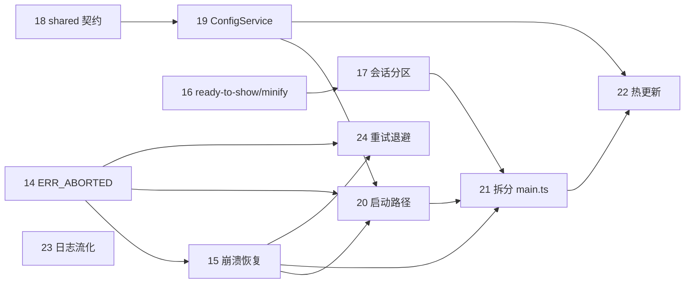

# 2026-10-29 架构与性能改进任务

触发原因：2026-10-29 架构与性能评审（会话内评审报告 `architecture-performance-review.md`）。评审逐一阅读了 `src/` 全部源码、`vite.config.ts` 与 `dist/` 产物，结论均对应到具体代码位置。

产品规格：`docs/electron-desktop-shell-product-spec-v2.1-cross-platform.md`（v2.1.1）。
实施基线：`docs/superpowers/plans/2026-10-28-electron-shell-cross-platform.md`（不修改基线计划；本组为按日期追踪的改进任务，遵守 AGENTS.md「不得重写已完成任务的历史记录」）。

> [!IMPORTANT]
> 标注「需规格变更」的任务属于对外可见行为变化：必须**先更新产品规格与受影响任务文件、经用户确认**，再实施代码（AGENTS.md「文档与规则维护」）。确认前状态保持 `blocked`。

## 任务总表

| 编号 | 状态 | 负责人 | 依赖 | 任务 | 评审项 | 需规格变更 |
|---:|---|---|---|---|---|---|
| 14 | 已完成 | Codex | 无 | [忽略 ERR_ABORTED 误触离线页](14-ignore-err-aborted.md) | R2（P0） | 否（缺陷修复） |
| 15 | 已阻塞 | Fable 5 | 14 | [渲染进程崩溃与无响应恢复](15-renderer-crash-recovery.md) | R1（P0） | 是（§7/§12 已更新，规格升 v2.1.2） |
| 16 | 已完成 | 待指派 | 无 | [首屏无白闪与产物压缩](16-ready-to-show-and-minify.md) | P2、P4 | 否 |
| 17 | 已完成 | Antigravity | 16 | [远程/本地会话分区与 SessionPolicy](17-session-partition.md) | A1（P0） | 是（已确认方案 A，§11/§14.1 已更新） |
| 18 | 已完成 | Antigravity | 无 | [shared 契约与依赖方向门禁](18-shared-contract-dependency-rules.md) | A4 | 否（需同步 `rules/architecture.md`） |
| 19 | 已完成 | Antigravity | 18 | [ConfigService 单一权威配置](19-config-service.md) | A3 | 否 |
| 20 | 待开始 | 待指派 | 14、15、19 | [启动关键路径优化](20-startup-critical-path.md) | P1 | 否 |
| 21 | 待开始 | 待指派 | 15、17、20 | [拆分 main.ts 平台适配器](21-split-main-composition-root.md) | A2 | 否 |
| 22 | 已阻塞 | 待指派 | 19、21 | [配置保存热更新分级](22-config-hot-apply.md) | A5 | 是（§5.2/§14.1） |
| 23 | 已完成 | Fable 5 | 无 | [日志写入流化与批量刷新](23-logger-write-stream.md) | P3 | 否 |
| 24 | 已阻塞 | 待指派 | 14、15 | [重试退避与离线页策略](24-retry-backoff.md) | P5 | 是（§7 重试语义） |

## 依赖与并行批次



| 批次 | 可并行任务（≤4，文件不重叠） | 说明 |
|---|---|---|
| 第 1 批 | 14、16、18、23 | 无依赖、文件边界互不重叠，可立即开始 |
| 第 2 批 | 15、19、17（规格确认后） | 15 与 17 都会触及 `src/main.ts`：分别负责不同函数，或串行执行 |
| 第 3 批 | 20、24（规格确认后） | 两者都改 `app-controller.ts`，需要明确接口或串行 |
| 第 4 批 | 21 → 22 | 21 是结构性搬迁，单独执行；22 在其后 |

## 文件所有权热点

以下文件被多个任务修改，同一时间只能由一个 `in_progress` 任务持有：

- `src/main.ts`：15、17、20、21
- `src/main/app-controller.ts`：14、15、19、20、24
- `src/main/window/window-manager.ts`：16、17、22
- `src/main/config/config-ipc.ts`：18、19、22

## 状态约定

- `pending` / 待开始：尚未实施。
- `in_progress` / 进行中：最多 4 项并行；每项必须有唯一负责人，并满足依赖和文件边界要求。
- `blocked` / 已阻塞：记录原因、已做检查和所需决策。
- `done` / 已完成：所有验证通过，且有任务对应的提交记录。

## 通用完成门禁

每个任务标记 `done` 前都必须执行并在任务文件中记录：

```powershell
npm run typecheck
npm run lint
npm test
npm run build
```
